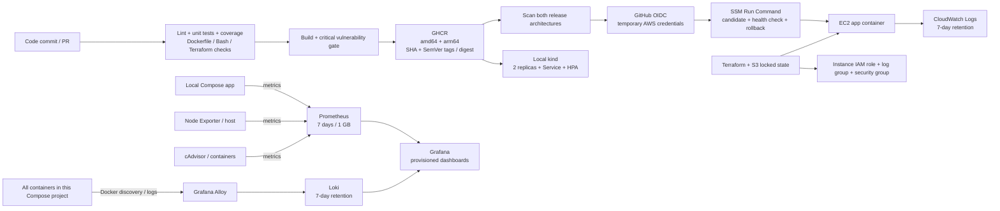
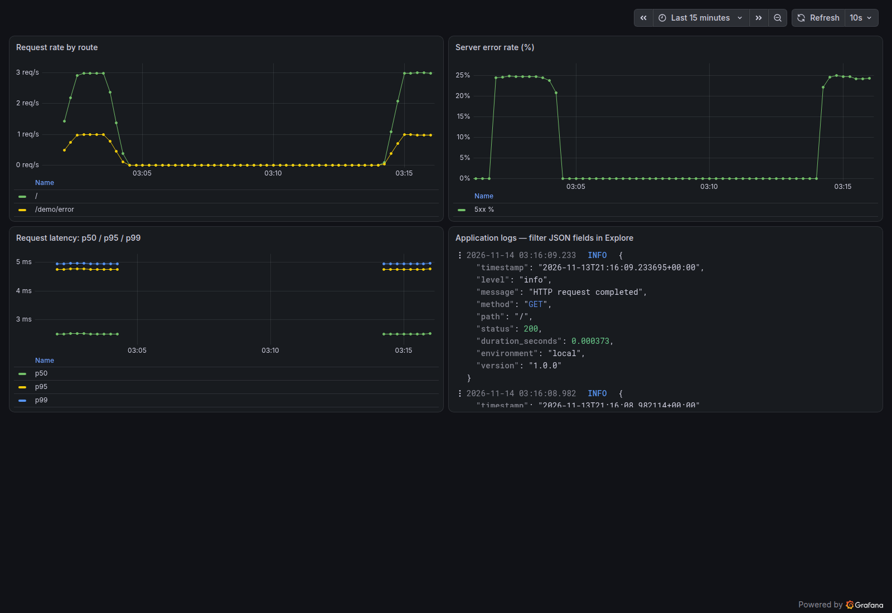
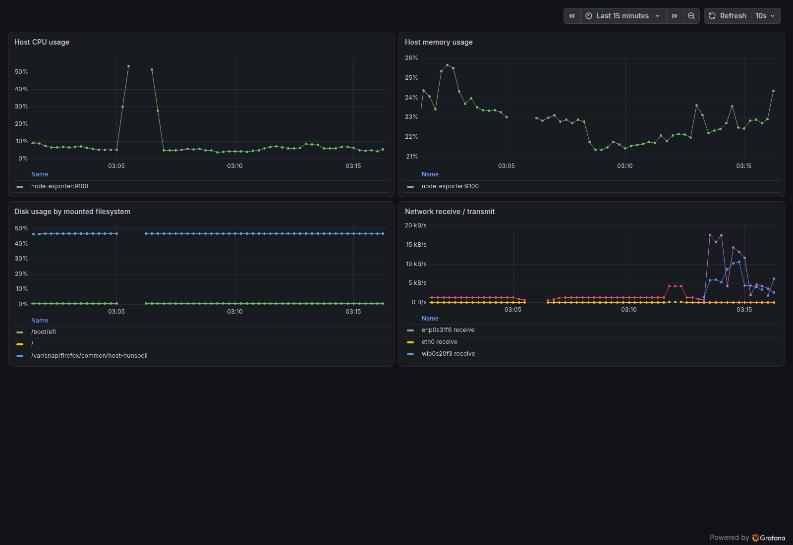
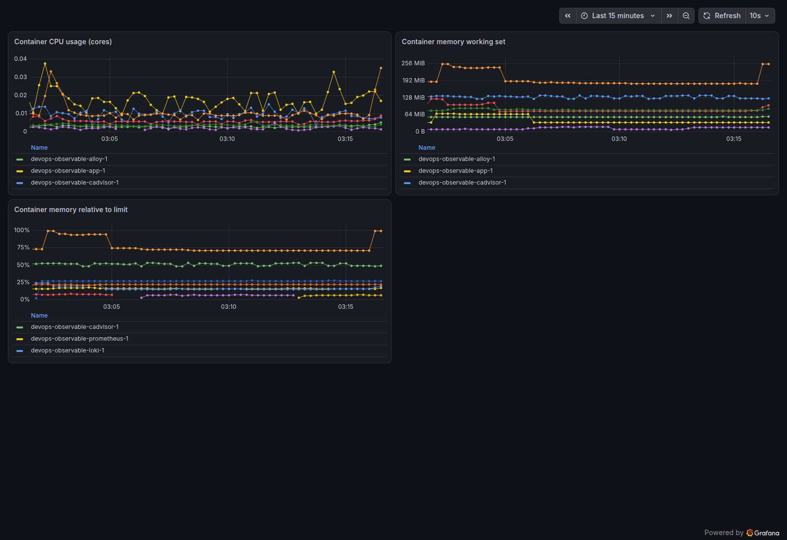

# DevOps Observable Service

A small Python/FastAPI service delivered through tested containers, GitHub Actions, Terraform on AWS, and local Kubernetes. Prometheus, Grafana, Loki, Grafana Alloy, Node Exporter, and cAdvisor provide metrics, dashboards, logs, and alert rules.

## Verification status

| Requirement | Evidence / current status |
|---|---|
| Python endpoints, configuration and startup | 19 tests pass; application coverage 94.69%; CI requires at least 90% |
| Docker hardening and health check | Built and run locally as UID/GID 10001 with a read-only root filesystem |
| Critical vulnerability gate | Local Trivy scan passed with zero CRITICAL vulnerabilities; repeated in CI |
| Monitoring and dashboards | All scrape targets up; app logs in Loki; screenshots below |
| Terraform | Both configurations validate; offline mocked security plan passes |
| Kubernetes | Two replicas running; HPA receives CPU metrics; real update and rollback completed |
| Zero-downtime demonstration | 320 in-cluster requests, 0 failures, both 1.0.0 and 1.0.1 observed |
| GitHub Actions release | [PR CI passed](https://github.com/sakibulhaque2002/DevOps-observable-service/actions/runs/43510692334); [multi-architecture release and both scans passed](https://github.com/sakibulhaque2002/DevOps-observable-service/actions/runs/43511047185) |
| Actual AWS plan/apply and SSM deployment | Pending account activation and authentication; no cloud apply is claimed yet |

See [the evidence index](docs/evidence/README.md). Mocked Terraform tests and deployment-script stand-ins are development checks, not proof of a real AWS deployment.

## Architecture



The complete monitoring stack runs locally. The assessment EC2 instance runs the app and ships its logs to CloudWatch; the local Prometheus configuration does not scrape EC2 or Kubernetes automatically.

## Prerequisites

Linux is required for the host monitoring mounts and health script. Allocate roughly 4 GB of free RAM for the local stack plus kind. Docker Desktop users will observe its Linux VM rather than their physical macOS/Windows host; use a Linux machine for matching host metrics.

| Tool | Version tested / purpose |
|---|---|
| Python | 3.12.3 locally, 3.13.18 in the container |
| [uv](https://docs.astral.sh/uv/getting-started/installation/) | 0.12.7; locked Python dependencies |
| [Docker Engine](https://docs.docker.com/engine/install/) | 29.1.3; includes Docker access for your user |
| Docker Compose / Buildx | 2.40.3 / 0.39.0 |
| [Terraform](https://developer.hashicorp.com/terraform/install) | 1.17.2; native S3 locking needs 1.10+ |
| [kind](https://kind.sigs.k8s.io/docs/user/quick-start/) / kubectl | 0.33.0 / 1.35.0 |
| AWS CLI v2 | 2.40.3; browser login, only needed for AWS work |
| Bash tools | Bash 4+, awk, coreutils, procps, util-linux/flock, curl, OpenSSL |
| Linters | ShellCheck 0.11.0, Hadolint 2.14.0; CI runs these checks |

Clone the repository and run commands from its root:

```bash
git clone https://github.com/sakibulhaque2002/DevOps-observable-service.git
cd DevOps-observable-service
cp .env.example .env
chmod 600 .env
```

Edit `.env` and set `GRAFANA_ADMIN_PASSWORD` to a unique generated value (`openssl rand -hex 24`). This password is required by Compose interpolation even when starting only the app. `.env` is ignored by Git. The generated working environment already has a local password; fresh clones must set their own.

## Run the application and monitoring locally

```bash
# App only:
docker compose up -d --build app
curl --fail http://localhost:8080/
curl --fail http://localhost:8080/health
curl --fail http://localhost:8080/metrics

# Full required stack:
docker compose --profile monitoring up -d --build
docker compose --profile monitoring ps
```

Expected root response:

```json
{"message":"Hello from DevOps Task!","status":"running","version":"1.0.0"}
```

Open [Grafana](http://localhost:3000), sign in using `GRAFANA_ADMIN_USER` and `GRAFANA_ADMIN_PASSWORD` from your `.env`, then open **Dashboards → DevOps Assessment**:

- [Application](http://localhost:3000/d/devops-application/application): request rate, 5xx percentage, latency p50/p95/p99, and related JSON logs.
- [Host](http://localhost:3000/d/devops-host/host): CPU, memory, mounted-filesystem usage, and physical-interface network traffic.
- [Containers](http://localhost:3000/d/devops-containers/containers): per-container CPU, working-set memory, and memory as a percentage of its configured limit. This dashboard selects this Compose project's container names.

Wait for at least two 15-second scrapes before expecting rate charts. Create requests with `curl` to populate application series. Histograms report bucket-based estimates, including sub-5ms requests in the first bucket.

Only the application (localhost:8080) and Grafana (localhost:3000) publish ports. None of the monitoring backends or collectors publish a host port. Their traffic uses the `internal: true` observability network; the app and Grafana additionally join a frontend network so localhost port publishing works.

```bash
# Inspect Prometheus without publishing its port:
docker compose exec app python -c 'import urllib.request; print(urllib.request.urlopen("http://prometheus:9090/api/v1/targets").read().decode())'
# Check rules and configuration:
docker compose exec prometheus promtool check config /etc/prometheus/prometheus.yml
docker compose exec prometheus promtool check rules /etc/prometheus/alerts.yml
# View app JSON logs:
docker compose logs --tail=20 app
# Stop, retaining collected data:
docker compose --profile monitoring down
```

Named volumes retain monitoring data. `docker compose --profile monitoring down -v` also deletes that local data; use it only when you want a fresh stack. Grafana's initial admin password is stored in its database: changing `.env` alone does not reset a password after the first startup.

### Dashboard screenshots

These screenshots show actual local data. The error spike comes from the explicitly enabled demo endpoint.





### Investigate an error spike

1. On Application, select the time range containing the spike. Compare request rate and latency to determine whether increased load coincides with failures.
2. Open the adjacent logs panel in Explore and query `{service="app",level="error"} | json | status >= 500`. Narrow by route with `| path="/demo/error"`. The JSON `version` field helps associate errors with a release.
3. On Containers, inspect the app's CPU and working-set memory relative to its 128 MiB limit. Check for restarts using `docker compose ps` and `docker inspect`.
4. On Host, check CPU, available memory, disk usage, and network activity. If infrastructure is healthy and the spike started at a deployment, inspect the release and roll it back if needed.
5. For the screenshot demo, logs identify the intentional `/demo/error` failures. Disable the demo again after collecting evidence.

To generate real demo failures, set `ENABLE_DEMO_ENDPOINTS=true` and a new random `DEMO_TOKEN` in your ignored `.env`, then recreate the app:

```bash
docker compose up -d app
# Read the token locally without placing it literally in command history:
read -rsp 'Demo token from .env: ' DEMO_TOKEN; echo
export DEMO_TOKEN
for i in {1..240}; do
  curl -s -o /dev/null http://localhost:8080/
  curl -s -o /dev/null -H "X-Demo-Token: $DEMO_TOKEN" http://localhost:8080/demo/error
  sleep 1
done
unset DEMO_TOKEN
```

The demo route is absent by default, requires its token when enabled, and never logs that token. Reset `ENABLE_DEMO_ENDPOINTS=false`, clear `DEMO_TOKEN`, and recreate the app afterward.

### Alert thresholds and retention

Rules live in [monitoring/alerts.yml](monitoring/alerts.yml). Grafana's Prometheus data-source Explore can evaluate `ALERTS`; the internal Prometheus `/api/v1/rules` endpoint shows rule state. No external notification receiver is configured; Alertmanager routing is a future improvement.

| Alert | Threshold and `for` duration | Reasoning |
|---|---|---|
| ApplicationDown | `up == 0` for 1 minute | Several failed scrapes filter a brief restart but detect sustained app/network failure quickly. |
| HighApplicationErrorRate | 5xx >5%, at least 20 requests/5m, for 2 minutes | Avoid a single low-volume failure paging someone; require sustained user-visible errors. |
| HostDiskAlmostFull | >80% used for 5 minutes, writable filesystems | Leave cleanup headroom and ignore short writes and read-only media. |
| ContainerMemoryNearLimit | Working set >90% of a finite nonzero limit for 3 minutes | Warn before OOM while avoiding transient spikes and unlimited-container divisions. |

Prometheus retains up to **7 days or 1 GB**, whichever limit removes older blocks first. Loki retains **7 days**, with TSDB/v13, a 24-hour index period, and compactor deletion enabled. Deletion is asynchronous; Loki filesystem storage is not a disk-space quota. Docker JSON logs rotate at 10 MB × 3 files per container. Alloy persists log positions across restarts.

## Application configuration and tests

| Environment variable | Default | Purpose |
|---|---|---|
| `PORT` | `8080` | Listening port; invalid values fail startup |
| `LOG_LEVEL` | `INFO` | Python log level; invalid values fail startup |
| `ENVIRONMENT` | `local` in Python; `production` in image | Log context |
| `APP_VERSION` | `1.0.0`, overridden by image build | Root endpoint and log version |
| `ENABLE_DEMO_ENDPOINTS` | `false` | Opt-in failure demo |
| `DEMO_TOKEN` | unset | Required token if demo is enabled |

```bash
uv sync --frozen
uv run --frozen ruff check app tests scripts/*.py
uv run --frozen ruff format --check app tests scripts/*.py
uv run --frozen pytest
uv run --frozen python -m app
```

Tests cover endpoints, bounded unknown-route labels, histogram/counter output, environment validation, demo protection, startup configuration, Linux health JSON/rotation, and the real Bash deployment control flow using Docker/curl stand-ins. Coverage XML is uploaded in CI. Uvicorn runs as the container process, handles SIGTERM, and drains requests for up to 20 seconds; container and Kubernetes stop timeouts are 30 seconds.

Python runtime dependencies, including transitive packages, are pinned in `requirements.txt`; `uv.lock` also locks development dependencies. After intentionally changing `pyproject.toml`, run `uv lock` and:

```bash
uv export --frozen --no-dev --no-hashes --no-emit-project --output-file requirements.txt
```

## CI/CD and required GitHub configuration

[CI](.github/workflows/ci.yml) runs on pull requests and is called by the release workflow. It performs Python linting/formatting, tests with a 90% application coverage floor, Dockerfile linting, ShellCheck, Compose validation, Terraform validation/mocked security tests, Kubernetes rendering, a hardened-container smoke test, SIGTERM verification, and a Trivy CRITICAL gate. Unfixed CRITICAL findings also fail; there is no ignore list.

[Release](.github/workflows/release.yml) runs on pushes to `main` or manual dispatch on `main`, after CI passes. It builds `linux/amd64` and `linux/arm64` with separate GitHub Actions layer caches, pushes to GHCR, attaches SBOM/provenance, and scans both architectures before allowing deployment. Actions are pinned to full commit hashes.

Every release gets `sha-<full-commit-SHA>` and a unique valid semantic version such as `1.0.0-build.12`. `1.0.0` is the application baseline; `build.12` is a prerelease identifier generated from the workflow run number. EC2 deployment uses the manifest digest, not a mutable `latest` tag. Re-running the same workflow can rebuild the same tags; use its recorded digest for precise rollback.

Under **Repository → Settings → Secrets and variables → Actions → Variables**, configure after Terraform apply:

| Repository variable | Value |
|---|---|
| `AWS_REGION` | `us-east-1` |
| `AWS_ROLE_ARN` | Terraform `github_deploy_role_arn` output |
| `EC2_INSTANCE_ID` | Terraform `instance_id` output |

No manually supplied GitHub secret is needed: the built-in `GITHUB_TOKEN` publishes images, and GitHub OIDC obtains short-lived AWS credentials. The deploy job deliberately skips while the role/instance variables are unset, allowing initial image publication before AWS exists. That skip is not successful AWS deployment evidence.

**This project's first published GHCR image was verified accessible anonymously.** EC2 pulls anonymously, so verify public package visibility again if you fork or recreate the project. A public GitHub repository does not by itself guarantee package visibility. If needed, change visibility under the package's settings, then confirm `docker pull ghcr.io/sakibulhaque2002/devops-observable-service:sha-<SHA>` works without credentials before applying Terraform. Subsequent releases can then deploy automatically.

Use a feature branch and a PR for changes; require the three CI jobs before merging. The deploy role trusts exactly this repository's `main` ref and `sts.amazonaws.com` audience. If you add a GitHub deployment Environment, update the OIDC subject because environment-based subjects have a different format.

The first successful release is `1.0.0-build.1`, source commit `7a27025c592e656fa73d2bdac7a4dccd038904bb`. Its exact manifest digest is:

```text
ghcr.io/sakibulhaque2002/devops-observable-service@sha256:537a317940baae0e1a42de01e6d099758e05a51410896fb9d990a5cc237cb442
```

Both platforms were scanned before release completion. The `unknown/unknown` manifest entries are SBOM/provenance attestations, not extra runnable platforms. See [recorded GitHub evidence](docs/evidence/github-release.txt). The AWS deploy job was intentionally skipped; this proves publication and scanning, not deployment to EC2.

## Terraform and AWS deployment

The assessment testing budget is **$0 out of pocket**. Verify an active eligible AWS Free plan and available credits before creating resources; do not upgrade plans or enable services outside that plan for this assessment. Cloud execution is pending. The production estimate below describes ongoing list-price operation without credits, not money you must invest to complete the local project. [AWS Free plan terms](https://docs.aws.amazon.com/awsaccountbilling/latest/aboutv2/free-tier-plans.html)

The assessment target is one small EC2 instance in the default VPC. Terraform creates an encrypted gp3 disk, IMDSv2 enforcement, one application ingress rule, HTTPS egress, scoped IAM roles, a seven-day CloudWatch log group, and bootstrap/deployment automation. There is no SSH ingress, key pair, NAT gateway, EKS cluster, or static AWS access key. T3 CPU credits use Standard mode to avoid surplus-credit charges.

Use a non-root administrative identity to provision infrastructure. Authenticate through the AWS CLI's browser login or another temporary-credential method. Do not create root access keys. The initial operator needs permissions to create the Terraform-managed resources; the application and GitHub deployment roles have narrower permissions.

```bash
aws login
aws sts get-caller-identity
export AWS_REGION=us-east-1
```

### 1. Bootstrap the state bucket

This step creates AWS resources and must follow your account-plan and budget review. The bucket name must be globally unique. Use a private bucket, versioning, encryption, blocked public access, and TLS-only access; all are defined in `infra/bootstrap`.

```bash
export TF_STATE_BUCKET="devops-task-state-$(aws sts get-caller-identity --query Account --output text)"
terraform -chdir=infra/bootstrap init
terraform -chdir=infra/bootstrap plan -var="bucket_name=$TF_STATE_BUCKET" -out=bootstrap.tfplan
terraform -chdir=infra/bootstrap apply bootstrap.tfplan
```

The small bootstrap configuration uses local state to solve the bucket-creation dependency. Preserve its ignored state securely until cleanup. The application infrastructure uses remote S3 state and native S3 locking. S3 locking is enabled with `use_lockfile=true`; a separate DynamoDB table is unnecessary. [HashiCorp backend documentation](https://developer.hashicorp.com/terraform/language/backend/s3)

### 2. Configure and review the application plan

```bash
cp infra/backend.hcl.example infra/backend.hcl
cp infra/environments/staging.tfvars.example infra/environments/staging.tfvars
```

Edit the backend bucket and set its key to `staging/terraform.tfstate`. Edit staging variables: use your public IPv4 address with `/32` for `allowed_http_cidr`, and the full published `sha-...` image tag for `app_image`. Do not use the documentation's example CIDR or placeholder SHA unchanged.

```bash
terraform -chdir=infra init -reconfigure -backend-config=backend.hcl
terraform -chdir=infra fmt -check -recursive
terraform -chdir=infra validate
terraform -chdir=infra test
terraform -chdir=infra plan -var-file=environments/staging.tfvars -out=staging.tfplan
# Inspect the plan, cost implications, account, and region before applying:
terraform -chdir=infra apply staging.tfplan
terraform -chdir=infra output
```

Saved plans and state are ignored because they can include sensitive infrastructure data. An apply finishing proves resource creation, not necessarily successful cloud-init: wait for SSM to report the instance Online and inspect the application's health/logs.

```bash
aws ssm describe-instance-information
# Use Terraform's application_url from the permitted client network:
curl --fail http://YOUR_INSTANCE_PUBLIC_IP:8080/health
# CloudWatch log group name comes from Terraform output:
aws logs tail /devops-task/staging/app --since 10m
```

Amazon Linux bootstrap installs Docker, enables SSM, writes the root-owned deployment script, and starts a retrying systemd bootstrap service. The instance IAM role can publish only to the application's log group. SSM channel actions need wildcard resources because those operations do not support instance-level resource scoping; the GitHub role can send commands only to the exact target instance and AWS's RunShellScript document. GHCR is public, so no registry pull credentials or ECR permissions are needed on the instance.

### 3. Exercise GitHub deployment

Set the repository variables listed above. Re-run **Release and deploy** using workflow dispatch on `main`, then save a link or sanitized screenshot of its successful SSM deployment step in `docs/evidence`. The smoke test runs on EC2 through SSM against localhost, so GitHub-hosted runner IPs do not need inbound security-group access.

To provision production with the same code, use `production.tfvars.example`, a **separate backend key** `production/terraform.tfstate`, and a separate working checkout or reinitialize to the production backend. Check the active backend before every plan. If staging created the account-wide GitHub OIDC provider, production must set `create_github_oidc_provider=false`. Keep the provider until all dependent environments are destroyed. A real multi-environment pipeline should use separate environment-specific deployment roles and approvals.

### 4. Destroy after capturing evidence

```bash
terraform -chdir=infra plan -destroy -var-file=environments/staging.tfvars -out=destroy.tfplan
terraform -chdir=infra apply destroy.tfplan
```

Confirm EC2 termination, disk removal, log-group removal, and role/security-group cleanup. This deliberately removes the assessment application's retained CloudWatch logs, so capture evidence first. Repeat for production if you created it. Clear the GitHub EC2/role variables afterward to avoid future deploy attempts to a destroyed instance.

The state bucket has `force_destroy=false`. After all application resources are gone and you have securely retained any required evidence, empty **all versions and delete markers** of the state bucket through the S3 console, then run `terraform -chdir=infra/bootstrap destroy -var="bucket_name=$TF_STATE_BUCKET"`. Do not delete live environment state or destroy the shared OIDC provider while another environment needs it.

## Deployment & Rollback Strategy

EC2 deployment is serialized by GitHub workflow concurrency and an instance-side `flock`. The script pulls the requested digest, starts a resource-limited candidate bound to `127.0.0.1:18080`, and checks `/health`. If the candidate fails, the active release continues unchanged. If it passes, the script stops the existing app, retains it as `app-previous`, starts the new container on port 8080, and repeats the health check. A failure removes the new container, restores the old container, verifies it, and reports a failed deployment to GitHub. A failed first deployment reports that there is no previous release to restore.

This simple single-instance EC2 switch has a short interruption; it is not zero-downtime infrastructure. A reverse proxy or load balancer with two active targets would remove that limitation. The separate Kubernetes demonstration verifies uninterrupted traffic through its Service during update and rollback.

For a manual EC2 rollback, dispatch a recorded previous digest through the same script (via SSM or an authenticated SSM session):

```bash
sudo /opt/devops/deploy-container.sh ghcr.io/sakibulhaque2002/devops-observable-service@sha256:PREVIOUS_MANIFEST_DIGEST
```

The workflow calls the root-owned script installed by Terraform. Changing that script requires reapplying Terraform; `user_data_replace_on_change=true` replaces the assessment instance so bootstrap and reviewed source remain aligned. The workflow never executes pull-request code with AWS credentials.

## Kubernetes deployment and rollback

Kubernetes schedules Pods; a Deployment maintains replicas and update history; a Service routes traffic to ready Pods; an HPA adjusts replica counts based on observed CPU relative to each Pod's CPU request. A ConfigMap holds non-sensitive configuration, while a Secret is generated outside source control.

```bash
kind create cluster --config k8s/kind.yaml --wait 120s
docker build -t devops-observable-service:1.0.0 .
kind load docker-image devops-observable-service:1.0.0 --name devops-assessment
kubectl apply -f k8s/base/namespace.yaml
kubectl -n devops-task create secret generic runtime-secrets \
  --from-literal=demo-token="$(openssl rand -hex 32)"
kubectl apply -k k8s/overlays/local
kubectl -n devops-task rollout status deployment/app --timeout=120s
```

`k8s/secret.example.yaml` documents an empty object shape; it is not a usable credential. Do not apply it over a generated Secret. The demo is disabled, but the app Deployment references the generated token to demonstrate Secret injection. Never commit real Secret YAML: base64 is encoding, not encryption.

Install the vendored official **metrics-server v0.9.1** manifest. The extra flag below is a local-kind workaround for its kubelet certificate; do not use it on production EKS.

```bash
kubectl apply -f k8s/metrics-server.yaml
kubectl -n kube-system patch deployment metrics-server --type=json \
  -p='[{"op":"add","path":"/spec/template/spec/containers/0/args/-","value":"--kubelet-insecure-tls"}]'
kubectl -n kube-system rollout status deployment/metrics-server --timeout=120s
# Allow a metric collection interval:
kubectl -n devops-task top pods
kubectl -n devops-task get hpa
```

For access, use this documented alternative to Ingress:

```bash
kubectl -n devops-task port-forward service/app 8081:80
# In another terminal:
curl --fail http://localhost:8081/health
```

Build a second version, load it, and run the reproducible rollout/rollback demonstration:

```bash
docker build --build-arg VERSION=1.0.1 -t devops-observable-service:1.0.1 .
kind load docker-image devops-observable-service:1.0.1 --name devops-assessment
./scripts/k8s-rollout-demo.sh | tee docs/evidence/kubernetes-rollout.txt
```

The script sends traffic from a Job **through the ClusterIP Service**. A `port-forward service/...` session selects one Pod and can end when that Pod is replaced, so it would be a poor measurement of Service availability during rollout.

Actual recorded command/output excerpt (complete [rollout output](docs/evidence/kubernetes-rollout.txt) and [request samples](docs/evidence/kubernetes-requests.txt)):

```text
kubectl -n devops-task set image deployment/app app=devops-observable-service:1.0.1
deployment.apps/app image updated
deployment "app" successfully rolled out
kubectl -n devops-task rollout undo deployment/app
deployment.apps/app rolled back
deployment "app" successfully rolled out
cpu: 4%/70%   MINPODS 2   MAXPODS 5   REPLICAS 2
{"requests": 320, "failures": 0, "versions": ["1.0.0", "1.0.1"]}
```

Deployment settings include two replicas, `maxUnavailable: 0`, `maxSurge: 1`, five seconds of readiness before availability, startup/readiness/liveness probes, 100m/64Mi requests, 500m/128Mi limits, read-only root, dropped capabilities, seccomp, UID 10001, and no service-account token. HPA uses a 70% CPU target, two-to-five replicas, and a 120-second scale-down stabilization window. A single-node kind cluster demonstrates rollout behavior, not node-level high availability.

On EKS, replace local images with registry digests; use an AWS Load Balancer Controller Ingress, ACM TLS, and a real domain; distribute replicas across Availability Zones; add a PodDisruptionBudget and network policy; run metrics-server with validated kubelet TLS; manage secrets through Secrets Manager plus an external-secrets/CSI integration; use EKS Pod Identity or IRSA for AWS access; and add Karpenter or Cluster Autoscaler for node capacity. Deploy monitoring with durable storage, appropriate retention/capacity, and an actual alert receiver.

Cleanup: `kind delete cluster --name devops-assessment`.

## Linux health automation

```bash
./scripts/system_health.sh --help
./scripts/system_health.sh --cpu 90 --mem 85 --disk 80
./scripts/system_health.sh --json --log-file /tmp/health_log.txt
shellcheck scripts/*.sh
```

The collector samples `/proc/stat` over one second, uses `MemAvailable` for memory, reads all filesystems reported by `df -a`, captures 1/5/15-minute load and the top five processes by RSS, then appends a timestamped record. Filesystems reporting zero size are recorded but not threshold-tested. Unreadable mounts or other incomplete collection produce a critical result with available data retained. JSON is the only stdout content in `--json` mode; warnings go to stderr.

Exit codes are 0 healthy, 1 warning, 2 critical or collection/configuration failure. Warning defaults are CPU 90%, memory 85%, disk 80%; the common critical default is 95%. Thresholds trigger at or above the configured value. Flags must be integers, and warning thresholds must be below the critical threshold. Load average is reported for context rather than compared to a machine-independent threshold.

Logs default to `health_log.txt` in the current directory. Rotation defaults to 1 MiB and five backups, with a lock to serialize appends and rotation. A single large snapshot can exceed the size target; it rotates before the next write. Use `--max-log-bytes`, `--keep-logs`, and `--log-file` to change these settings. The script sets restrictive file permissions and `set -euo pipefail`.

Install the supplied systemd service/timer on a server:

```bash
sudo install -m 0755 scripts/system_health.sh /usr/local/bin/system_health.sh
sudo install -m 0644 scripts/system-health.service scripts/system-health.timer /etc/systemd/system/
sudo systemctl daemon-reload
sudo systemctl enable --now system-health.timer
systemctl list-timers system-health.timer
journalctl -u system-health.service
```

The timer runs every five minutes with a small random delay. `SuccessExitStatus=1 2` lets systemd treat completed health reports as successful execution; their actual exit codes and warning output remain visible in the journal. `LogsDirectory` provides the only writable persistent location under the service's filesystem hardening.

## Design Decisions

- **Python/FastAPI:** familiar, readable code with native ASGI lifecycle handling. One Uvicorn worker per container keeps counters process-local; scale containers instead of adding workers whose registries would require a multiprocess metric design.
- **Alpine and multi-stage wheels:** a digest-pinned Python image has a small runtime and supports a Python-based HEALTHCHECK without adding curl. BuildKit mounts built wheels during installation, so the runtime image does not retain wheel archives. Native dependencies must have compatible musl wheels; the build fails rather than silently installing unpinned compilers.
- **EC2 plus separate local Kubernetes:** EC2 directly demonstrates the requested bootstrap, IAM, SSM, logging, and rollback responsibilities at a small cost. ECS could reduce host maintenance; EKS suits a broader Kubernetes platform but adds control-plane cost and complexity that the assessment does not need.
- **Tags and secrets:** SHA tags identify source, SemVer tags aid review, and digest deployment identifies exact content. GitHub OIDC and the EC2 instance role replace static AWS keys. Local secrets stay in ignored `.env`; Kubernetes secrets are generated at runtime.
- **Metric/log cardinality:** metrics use route templates and collapse unknown URLs into `__unmatched__`; uncommon HTTP methods become `OTHER`. Loki indexes bounded service/container identity and log level. Path, status, timestamp, and version stay as JSON fields for query-time filtering; IDs, arbitrary URLs, and tokens never become labels.
- **Local retention/storage:** named volumes and filesystem Loki make the demo reproducible. Production needs durable object storage, capacity planning, authentication, backups, and alert delivery.

The final local amd64 image reports **20,666,449 bytes (20.67 MB / 19.71 MiB)** with `docker image inspect devops-observable-service:1.0.0 --format '{{.Size}}'`. This Docker Engine measurement is architecture/engine-specific and should not be confused with a registry's compressed transfer size.

## Security Considerations

The app runs without root, writable root storage, extra Linux capabilities, or a service-account token. HTTP is appropriate only for the restricted assessment endpoint; production needs authenticated administration and TLS termination. Metrics have no application authentication and remain internal in Compose; production network policy should restrict scrapers.

Node Exporter mounts `/proc`, `/sys`, and `/` read-only and joins the host PID namespace to observe host resources. `/proc/1/net` is additionally mounted at its procfs network view, with netlink collection disabled, so it reads **host** network counters while remaining on the internal Docker network. cAdvisor uses read-only host-root, `/sys`, Docker runtime/socket and data mounts, the host cgroup namespace, and privileged mode for host/container accounting. This broad host access is isolated to the monitoring collector; the application has no equivalent grants.

Alloy runs as root to read the Docker socket, mounted read-only, and discovers every container **in this Compose project**. A read-only socket mount still allows powerful Docker API calls: it is not an API authorization boundary. Production should use a restricted socket proxy or another collection mechanism. Project-scoped discovery avoids ingesting unrelated applications' logs on a shared developer machine. No collector is exposed on a host port.

Image/runtime versions and Actions revisions are pinned; Trivy gates CRITICAL findings and Dependabot proposes updates. The instance role scopes CloudWatch permissions to its log group; the deployment role targets one EC2 instance. S3 state is encrypted, versioned, locked, TLS-only, and blocked from public access. Terraform state remains sensitive; never commit it or supply credentials through backend files. The default AWS VPC and a single public instance are assessment simplifications.

## Rough monthly AWS cost

Estimate for the current single-instance footprint in `us-east-1`, 730 hours/month, Linux on-demand, before credits, free allowances, taxes, and variable data transfer:

| Item | Assumption | Approx. USD/month |
|---|---|---:|
| EC2 t3.micro | 730 × $0.0104/hour | $7.59 |
| One public IPv4 | 730 × $0.005/hour | $3.65 |
| gp3 root disk | 8 GiB × $0.08/GiB-month, baseline performance | $0.64 |
| CloudWatch logs | Low traffic, approximately 2–6 GB ingested; seven-day storage | $1–3.20 |
| S3 state and requests | Small versioned state files, low request count | approximately $0.10 |
| **Total** | Small single-instance baseline | **approximately $12–16/month** |

Pricing references checked November 14, 2026: [EC2 example rates](https://docs.aws.amazon.com/prescriptive-guidance/latest/optimize-costs-microsoft-workloads/right-size-selection.html), [public IPv4 pricing](https://aws.amazon.com/vpc/pricing/), [gp3 rates](https://docs.aws.amazon.com/prescriptive-guidance/latest/optimize-costs-microsoft-workloads/ebs-migrate-gp2-gp3.html), [CloudWatch pricing](https://aws.amazon.com/cloudwatch/pricing/), and [S3 pricing](https://aws.amazon.com/s3/pricing/). This is an estimate from those assumptions, not a quoted bill. Logging, network egress, retained versions, and a different instance type can increase it. The monitoring stack and kind run on the local machine and are excluded from AWS cost. A highly available production design would additionally budget for redundant compute, load balancing, TLS/domain infrastructure, and hosted monitoring.

## What I would improve with more time

Add a reverse proxy/load balancer for uninterrupted EC2 traffic, independent environment deployment approvals, Cosign signing and verification, an Alertmanager receiver, service-level objectives and burn-rate alerts, network policy and disruption budgets, a durable production monitoring deployment, automated recovery exercises, and workload-based resource tuning. Replace default-VPC assumptions with a reusable network module when the target environment warrants it.

## AI assistance

OpenAI Codex assisted with implementation, configuration, tests, documentation, and local verification. The repository distinguishes generated configuration, mocked checks, real local evidence, and pending cloud evidence. I review the changes and must be able to explain each part; AI assistance does not substitute for actual deployment results.
